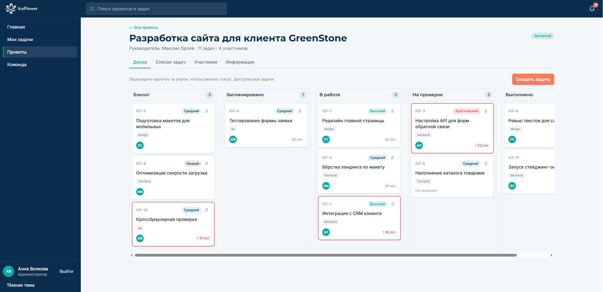
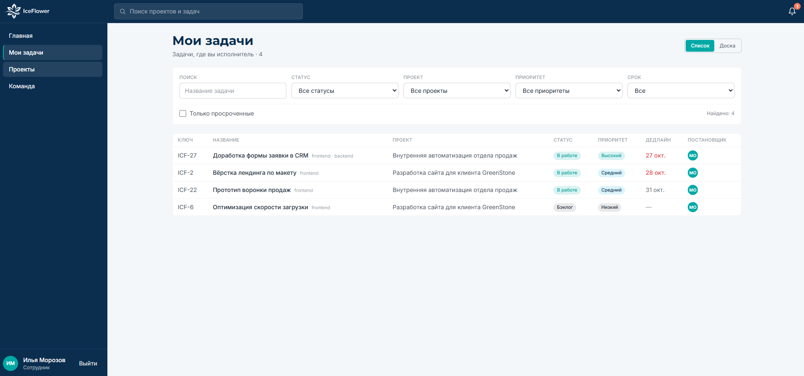

<div align="center">


# IceFlower Tasks

**Командный трекер задач и проектов**

Управление проектами, Kanban-доски и командная работа в едином интерфейсе.

[🚀 Открыть демоверсию](https://ice-flower-black.vercel.app/) · [💻 Исходный код](https://github.com/OldZepp/IceFlower)

</div>

---

## О проекте

**IceFlower Tasks** — демонстрационный MVP внутреннего трекера задач для команды около 35 человек. Проект ориентирован на повседневную работу с задачами без избыточной сложности корпоративных систем управления.

## Возможности

- **Kanban-доска:** пять колонок с перетаскиванием задач (drag-and-drop).
- **Проекты и задачи:** назначение исполнителей, приоритеты, дедлайны, теги, ссылки и история изменения статусов.
- **Роли и доступ:** администратор (`admin`) и участник (`member`).
- **Комментарии:** авторство и время публикации, права на редактирование и удаление.
- **Поиск и фильтры:** задачи по проектам, статусам, приоритетам и срокам; представление списком и доской.
- **Уведомления:** назначения задач и новые комментарии внутри приложения.
- **Настройки профиля:** имя, должность, светлая и тёмная темы.
- **Адаптивный интерфейс:** работа на компьютере, планшете и смартфоне.

## Технологии

| Назначение | Технологии |
| --- | --- |
| Приложение | Next.js 16, React 19 |
| Язык | TypeScript |
| Стили | Tailwind CSS 4 |
| Перетаскивание задач | `@hello-pangea/dnd` |
| Аутентификация | NextAuth.js 5 |
| Работа с данными | Prisma 6 |
| Демо-база | SQLite |

## Онлайн-демо

**Адрес:** https://ice-flower-black.vercel.app/

В приложении предусмотрены демонстрационные пользователи и быстрый вход. Доступность демоверсии и состояние данных могут изменяться.

## Скриншоты

Скриншоты интерфейса будут добавлены позднее.

<!--
Когда изображения будут загружены, например в docs/screenshots/,
можно включить их так:


-->

## Локальный запуск

**Потребуется:** Node.js и npm.

```bash
# Клонировать репозиторий
git clone https://github.com/OldZepp/IceFlower.git
cd IceFlower

# Установить зависимости
npm install

# Создать файл локальных настроек
cp .env.example .env
```

Откройте `.env` и настройте переменные среды, в том числе `DATABASE_URL` и `AUTH_SECRET`. Секрет необходимо сгенерировать индивидуально; **не публикуйте файл `.env`**.

```bash
# Создать таблицы
npm run db:push

# Заполнить базу демонстрационными данными
npm run db:seed

# Запустить сервер разработки
npm run dev
```

Откройте http://localhost:3000.

Для производственной сборки:

```bash
npm run build
npm run start
```

> Примечание: демоконфигурация использует SQLite. Для реального многопользовательского развёртывания требуется отдельная проверка базы данных, хранения данных и настроек безопасности.

## Фирменный стиль

Интерфейс следует брендбуку IceFlower: глубокий синий **Deep Fjord**, бирюзовый **Aurora Teal**, голубой **Glacier** и коралловый **Northern Sun**. Предусмотрены светлая и тёмная темы.

Шрифты: **Montserrat** для заголовков и **Inter** для основного текста.

## Структура проекта

- `app/` — страницы, маршруты и основная логика Next.js.
- `components/` — интерфейсные компоненты.
- `lib/` — вспомогательная логика.
- `prisma/` — схема и демонстрационные данные БД.
- `public/` — статические ресурсы.
- `types/` — типы TypeScript.

## Автор

Разработка и оформление проекта: **[OldZepp](https://github.com/OldZepp)**.

*IceFlower © 2026*
